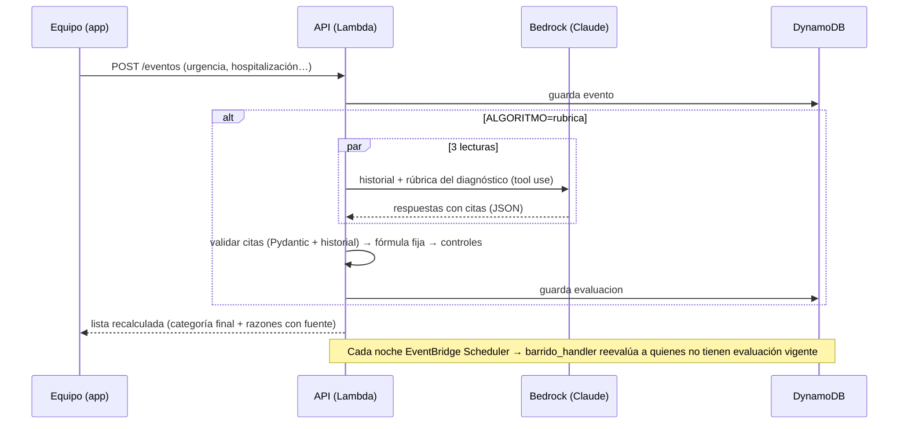

# Diseño — Algoritmo decisor "rúbrica + fórmula fija"

**Idea:** el LLM **lee** el historial y contesta una rúbrica cerrada con citas; el **código decide** la categoría y el
orden con la Tabla SSMSO 2025 del HLF y el Ord. MINSAL 536/2025. Si algo no cuadra, manda la regla actual y una persona.

## Módulos

| Archivo | Responsabilidad |
|---|---|
| `lambda/conocimiento/ssmso_hlf_2025.json` | Filas de la tabla del HLF para los 17 diagnósticos, con página y texto literal del PDF |
| `lambda/conocimiento/ord536.json` | Cascada de orden (sin LACE) |
| `lambda/conocimiento/pubmed_evidencia.json`, `guias_umbrales.json` | Ventanas tras un evento (PMID) y umbrales de mediciones (guías) |
| `lambda/conocimiento/rubrica_v1.json` | Base consolidada (la genera `scripts/consolidar_rubrica.py`) + pendientes para médicos |
| `lambda/rubrica.py` | Historial hasta la fecha de corte, prompt, esquema Pydantic, validador de citas, cliente Bedrock y cliente falso, lector determinista |
| `lambda/decisor.py` | Función pura rúbrica → categoría, razones con fuente; `clave_orden_536` |
| `lambda/controles.py` | cita inválida, inestable, bajaría, discrepancia, dato desconocido, fallo LLM |
| `lambda/algoritmo.py` | Orquesta 3 lecturas en paralelo + fórmula + controles → registro auditable |
| `lambda/app.py` | `ALGORITMO`, evaluación al registrar un evento, `/pacientes/{id}/evaluar`, `/pacientes/{id}/evaluaciones`, `/algoritmo/barrido`, `barrido_handler` |
| `scripts/evaluar_algoritmo.py` | Evaluación offline: brazos A, R, E+F y E0; kappa ponderado con IC95 si hay etiquetas médicas |
| `scripts/buscar_pubmed.py` | Verifica los PMID con NCBI E-utilities y congela la evidencia (desarrollo, no en la Lambda) |

## Esquema de la respuesta (Pydantic, `rubrica.RespuestaRubrica`)
```
evento_grave:                       {valor: si|no|desconocido, citas: [{fecha, tipo, valor}]}
estabilizado_despues:               {valor: si|no|desconocido, citas: [...]}
tendencia_medicion:                 {valor: empeora|estable|mejora|desconocido, citas: [...]}
cambio_tratamiento_por_mal_control: {valor: si|no|desconocido, citas: [...]}
senal_no_cubierta:                  texto breve (no cambia la categoría; solo revisión)
```
Salida estructurada: Converse con una herramienta obligatoria (`toolChoice`), esquema sin `$ref` (con referencias el
modelo a veces envolvía la respuesta). Sin `temperature`. Timeout 20 s, 2 reintentos (en la evaluación offline 40 s y 6).

## Prompt
- **Sistema:** lee y responde, no prioriza; usa solo el historial; "desconocido" si falta el dato (no es "no"); cada "sí"
  con cita exacta; tendencia con al menos dos mediciones; señal no cubierta solo si es relevante.
- **Usuario:** diagnóstico, ingreso, fecha de corte, edad, sexo, comorbilidades, eventos y mediciones (≤ corte) y
  **solo la rúbrica de su diagnóstico** (con su medición clave). Sin ejemplos de los 30 casos etiquetados.

## Fórmula (decisor.decidir)
1. Base = prioridad de la SIC.
2. Evento grave citado, sin estabilización posterior y dentro de la ventana con fuente → sube a la fila "descompensado"
   del HLF (solo si la fila tiene fuente). Fila alta + evento grave → descompensación grave (va primero, revisar en 72 h).
3. Medición clave que empeora y supera un umbral **con fuente**, en un diagnóstico cuya tabla define el estado por
   control metabólico (DM2 descontrolada) → sube a esa fila. En el resto, solo revisión.
4. Cambio de tratamiento por mal control, señal no cubierta o fila "a validar" → revisión (no mueve).
5. Nunca baja.

## Controles (controles.evaluar)
`fallo_llm`, `cita_invalida`, `inestable` (3 corridas distintas), `bajaria`, `discrepancia` (> 1 nivel vs reglas),
`dato_desconocido`. Cualquiera de ellos → categoría de las reglas + `requiere_revision`.

## Secuencia


## Integración
- `ALGORITMO=reglas` (por defecto): `lista()` no cambia en nada.
- `ALGORITMO=rubrica`: `lista()` aplica la última evaluación **vigente** de cada paciente (misma huella del historial a
  la fecha de corte) y ordena con `clave_orden_536`. Sin evaluación vigente → reglas, marcado en `algoritmo`.
- Campos nuevos opcionales (solo con `rubrica`): `algoritmo`, `rubrica`, `controles`.
- Registros en la misma tabla DynamoDB (`sk = evaluacion#fecha`); no se crean tablas nuevas.
- Barrido: función aparte con timeout largo y regla de EventBridge Scheduler (en `template.yaml`, apagada hasta aprobar).
