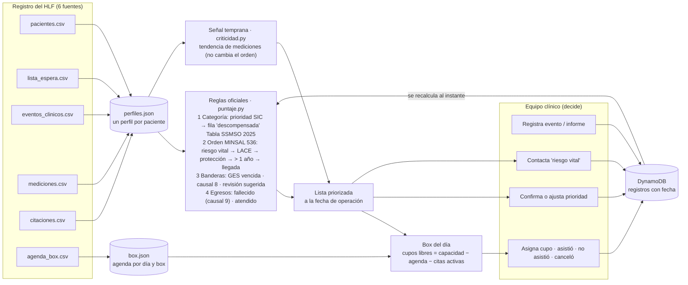
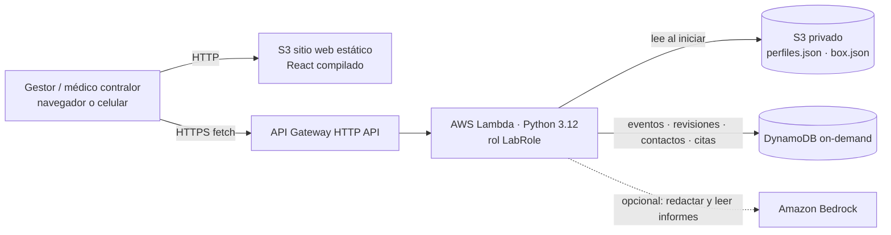

# Arquitectura — Ambulatorio Dinámico HLF

> "La lista de espera es una foto; la salud de las personas, una película."
> La lista se recalcula cada vez que llega un dato nuevo del paciente, con reglas oficiales y explicables, y los cupos
> reales de los box se asignan en ese orden. El equipo clínico decide y todo queda trazado.

## 1. Flujo de los datos

**Principio de la fecha de corte:** todo se calcula con los registros con fecha ≤ al día de operación elegido (días hábiles
con agenda, del 14-04 al 13-10-2026). Al retroceder un día se ve la lista y los box tal como estaban ese día.

## 2. Servicios AWS (despliegue simple, AWS Academy)

| Pieza | Servicio | Por qué |
|---|---|---|
| Front | S3 (website) | Sin servidor ni build en la nube: `npm run build` + `aws s3 sync` |
| API | API Gateway HTTP + Lambda | Paga por uso; escala sola; una sola función con todas las rutas |
| Datos base | S3 privado y cifrado | El dataset del hospital nunca está en el repo ni es público |
| Registros del equipo | DynamoDB | Trazabilidad de cada decisión (quién, cuándo, a qué fecha) |
| IA | Bedrock (opcional) | Solo redacta y lee informes; si no está, plantillas y palabras clave |

Plantilla: `template-lab.yaml` (sin crear roles IAM, usa `LabRole`). Script: `scripts/desplegar_lab.sh`.
Para una cuenta propia con permisos IAM y Amplify, ver `template.yaml` y DEPLOY.md.

## 3. Cómo resuelve el desafío
1. **La prioridad deja de estar congelada.** Cada evento (urgencia, hospitalización, examen alterado) recalcula la lista
   en milisegundos con la tabla oficial del HLF y el orden MINSAL: reevaluación < 72 h → inmediata.
2. **Criterio común para el 100 % de la lista,** explicable: cada posición trae sus razones con la fuente oficial.
3. **Uso real de los box.** Los cupos libres de la agenda se asignan en el orden de la lista; si alguien no asiste o
   cancela, el cupo se libera y pasa al siguiente. Las inasistencias no bajan la prioridad (causal 8 solo como bandera).
4. **El equipo decide.** Confirmar / ajustar con motivo (kappa de concordancia), contacto del riesgo vital, resultado de
   cada cita: todo queda en DynamoDB.
5. **Validado con el registro** (`scripts/validar_priorizacion.py`): los 15 pacientes que fallecieron estaban, 7 días antes,
   en el 5 % superior de la lista con estas reglas (mediana) vs el 47 % en la lista estática.
